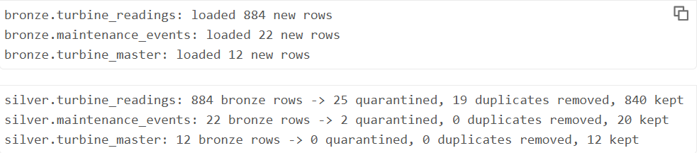
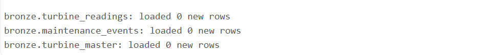
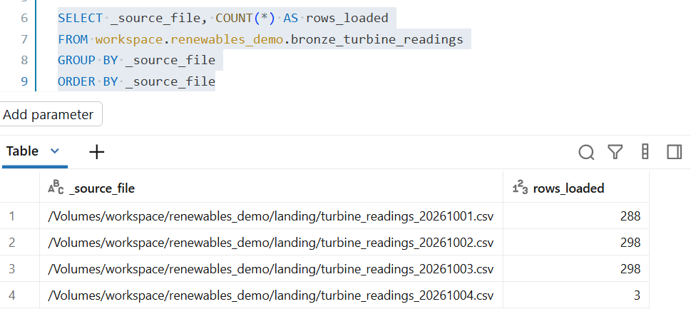
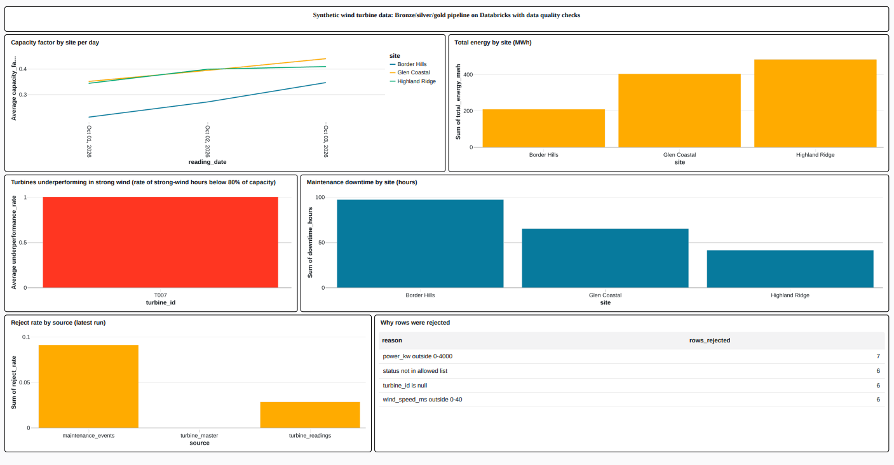
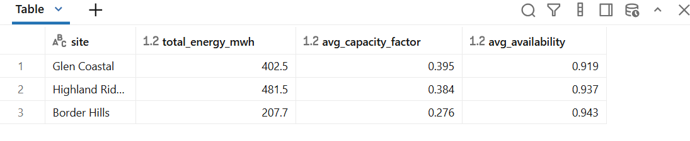
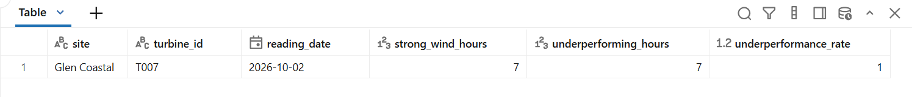
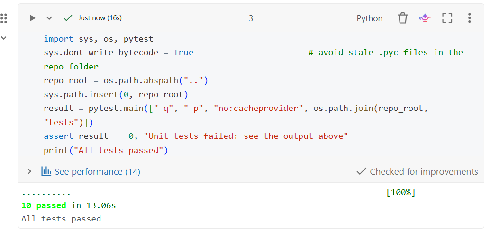

# Renewables data pipeline on Databricks (bronze / silver / gold)

A learning project by **Niyoshi Soni**, built 31 October to 1 November 2026.

A small, metadata-driven data pipeline on Databricks (Free Edition, serverless) using PySpark, SQL and Delta Lake. It loads wind turbine data through bronze, silver and gold layers, with data quality rules, unit tests and automated checks on GitHub. **All data is synthetic**, made up for learning.

I work in analytics and reporting, so I built this to get hands-on practice with the engineering side: incremental ingestion, data quality, testing and delivery.

## What it does

1. **Landing:** the notebook creates daily CSV files for turbine readings, plus turbine master data and maintenance events. They include deliberately bad rows and a re-delivered duplicate.
2. **Bronze:** Auto Loader (Structured Streaming with `trigger(availableNow=True)`) loads only new files into Delta tables. Everything stays as text, with lineage columns (`_source_file`, `_ingested_at`). A checkpoint remembers which files were processed, so a second run loads 0 new rows.
3. **Silver:** a list of source settings (`SOURCES`) drives typing, rules and keys, so a new source is a new entry, not new code. Rules cover not-null, value ranges and allowed values. Good rows are de-duplicated and upserted with Delta `MERGE`. Bad rows go to a quarantine table with the reason.
4. **Gold:** business-ready tables: site and day performance (energy, capacity factor, availability, wind speed), a rule-based turbine underperformance flag, a maintenance and downtime summary, and a data quality summary.
5. **Guard:** the run stops if a source's reject rate is above 10%.

## Results on Databricks (synthetic data)

| Step | Result |
|---|---|
| Bronze, first run | 884 turbine readings, 22 maintenance events, 12 turbines |
| Silver, turbine readings | 840 kept, 25 quarantined, 19 duplicates removed |
| Silver, maintenance events | 20 kept, 2 quarantined |
| Second run | 0 new rows loaded for every source |
| New file added later | only its 3 rows were loaded (887 turbine readings in bronze) |

**First run:**



**Second run, 0 new rows (the checkpoint at work):**



**Rows per source file in bronze, after adding a new file:**



## Dashboard

A Databricks SQL dashboard on the gold tables: capacity factor by site per day, total energy by site, turbines underperforming in strong wind, maintenance downtime, reject rate by source, and the reasons rows were rejected. The simulated fault on turbine T007 is the one the underperformance rule flags.



The gold tables behind it can be queried directly. Total energy and average capacity factor by site, and the turbine flagged as underperforming:




## Tests and CI

- 10 unit tests (pytest) cover the data quality functions: rules, bad values becoming null, the quarantine split and de-duplication.
- A GitHub Actions workflow runs the tests on every push.
- The same tests run inside Databricks (`notebooks/run_tests.py`).

**Tests passing in Databricks:**



## Project structure

```
notebooks/   renewables_medallion_v3.py (main pipeline), run_tests.py (runs the tests on Databricks)
src/         renewables/dq.py (reusable, unit-tested data quality functions)
tests/       pytest unit tests
sql/         dashboard_queries.sql (queries behind the dashboard)
.github/     GitHub Actions workflow (CI)
docs/        screenshots
```

## How to run it

1. Sign up for Databricks Free Edition and create a Git folder from this repository (Workspace, Create, Git folder).
2. Open `notebooks/run_tests.py` from the Git folder and run all. All tests should pass.
3. Open `notebooks/renewables_medallion_v3.py` from the Git folder and run all. If your catalog is not called `workspace`, change `CATALOG` near the top.
4. Run it again to see 0 new rows. Upload a new CSV (for example `turbine_readings_20261004.csv`) to the `landing` volume and run again to see only the new rows load.
5. Run the queries in `sql/dashboard_queries.sql` in the SQL editor and build a dashboard.

To run the tests on your own machine instead: `pip install -r requirements.txt` and `python -m pytest -q` (needs Java).

## Changes I made myself

1. **Closed a data quality gap.** The "allowed values" rule skips empty values, so a reading with no `status` would have passed. I added a not-null rule on `status`. No row in this data had an empty status, so the counts did not change, but the rule now protects future files.
2. **Added a test for it** that shows the gap (it passes without the new rule) and checks the new rule rejects the row.
3. **Tightened the underperformance threshold from 80% to 85%** of capacity in strong wind. The same turbine (T007) was flagged before and after, so no other turbine sat between 80% and 85%.
4. **Added a new gold metric**, `max_wind_speed_ms`, to the daily site table.

## Problems I hit and fixed

- **Strict casting on Databricks serverless.** A bad value such as `abc` in a numeric column raised an error instead of becoming null, and a test failed. I switched to `try_cast`, so bad values become null and the quarantine rules handle them.
- **Row counts from the stream came back empty.** I now count rows in the bronze table before and after each load.
- **A re-run that never finished.** The stream stayed open on serverless. I stop leftover streams, set a time limit on the wait, and stop the stream explicitly.
- **A failed CI run.** An indentation mistake in a test file made GitHub Actions fail with exit code 2. I read the log, fixed the indentation, and the tests passed again.

## What I learned

- Bronze keeps the raw text and lineage so nothing is lost, and silver is where types and rules are applied. Splitting them means a bad value never breaks a load.
- A checkpoint is what makes loading incremental and safe to re-run: the same files are never loaded twice.
- Quarantining bad rows with a reason is better than dropping them. The reasons show up on the dashboard, so someone can see what is wrong with the source.
- Code that works on my machine can fail on Databricks serverless because of stricter defaults, so I test in both places. Unit tests and CI caught problems early, including one of my own mistakes.

## Limitations

- The data is synthetic, so the results say nothing about real turbines.
- This is a learning project, not a production system. It runs incremental batches (`availableNow`), not an always-on stream.
- I have not set up scheduling or a Power BI connection. Possible next steps: a scheduled Databricks Job, Unity Catalog permissions and lineage, and Databricks Asset Bundles for deployment.
